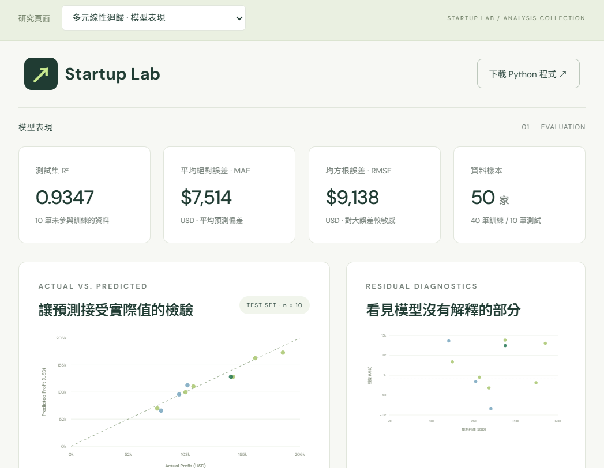

# Startup Lab

繁體中文 50 Startups 多元線性迴歸互動網站。資料來源為使用者指定 GitHub CSV，原始 Notebook 作為分析背景。

線上網站：https://startup-lab-iota.vercel.app/


## 分析頁面

- `index.html`：多元線性迴歸、模型表現、相關性矩陣與利潤試算。
- `selection.html`：前向特徵選擇，1–5 個特徵的比較結果、候選模型與 Markdown 結果下載。
- `upload.html`：自訂 CSV 分析，比較 OLS、Ridge、Lasso；資料僅在瀏覽器記憶體內處理。

自訂分析支援最高 5 MB、10,000 筆、50 欄資料。資料切分後，以訓練集進行缺失值填補、類別編碼及標準化。瀏覽器模型以 `regression-engine.js` 實作，`verify_engine.py` 核對與 sklearn 的一致性。

前向選擇以 `forward_selection.py` 重現。比較集被用於特徵選擇，因此該頁分數並非獨立的最終測試評估。

## 重現分析

```sh
python -m venv .venv
# Windows
.venv/Scripts/python -m pip install -r requirements.txt
.venv/Scripts/python train.py
node verify.cjs
npm run build
npm run dev
```

網站：http://localhost:3000。將 `train.py` 貼到 Kaggle Python Notebook 亦可執行（開啟 Internet）；圖表儲存為 `actual-vs-predicted.png`。

CRISP-DM：商業理解 → 資料理解 → 資料準備 → 建模 → 評估 → 部署。40/10 切分，random_state=0，先切分再擬合 Pipeline。州別 OneHotEncoder(drop='first')，California 為參考類別。使用全部三項支出和州別；不刪除異常點。

模型在 Python 訓練，係數匯出至 model.json，網站以同一組係數進行即時試算。R²、MAE、MSE、RMSE 均以 10 筆測試集計算。訓練集的表格預測不能當作樣本外評估；R² 不是準確率。網站為靜態頁面，沒有部署 Python 伺服器。

## Vercel

```sh
npx vercel login
npx vercel --prod --yes
```

vercel.json 設定建置指令和 dist 輸出。`.venv` 透過 .vercelignore 排除，不會上傳。
